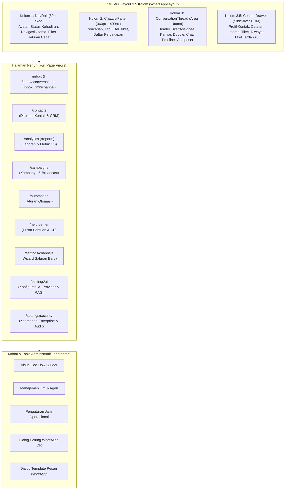

# Arsitektur Halaman & Komponen Antarmuka Xatxoot

> **Dokumen Acuan**: `docs/PAGES_AND_COMPONENTS.md`  
> Dokumen ini menyajikan katalog lengkap seluruh halaman, rute URL, komponen pembangun, dan kapabilitas antarmuka pengguna di aplikasi web frontend Xatxoot (`apps/web`).

---

## 1. Peta Navigasi & Struktur Layout

Antarmuka Xatxoot dirancang dengan filosofi **WhatsApp Web-Inspired** berbasis **Design System Astryx by Meta** yang dipadukan dengan pola layout 3.5 kolom untuk alur kerja customer service omnichannel.

---

## 2. Ringkasan Hak Akses Halaman

Pengguna dengan **Akses Penuh (Administrator / Super Admin)** memiliki izin untuk melihat dan mengoperasikan seluruh halaman dan modal tanpa batasan, sementara peran **Agent (Petugas CS)** dibatasi hanya pada operasional obrolan dan CRM.

| Kategori Halaman | Rute URL | Akses Penuh (Admin) | Agen (CS) | Publik / Tanpa Login |
| :--- | :--- | :---: | :---: | :---: |
| **Inbox Percakapan** | `/inbox`, `/inbox/:conversationId` | ✅ Penuh | ✅ Terbatas pada tiket tim/assignee | ❌ |
| **Kontak & CRM** | `/contacts` | ✅ Penuh | ✅ Lihat & edit kontak | ❌ |
| **Laporan & Analitik** | `/analytics` (`/reports`) | ✅ Penuh | ❌ | ❌ |
| **Kampanye & Broadcast** | `/campaigns` | ✅ Penuh | ❌ | ❌ |
| **Aturan Otomasi** | `/automation` | ✅ Penuh | ❌ | ❌ |
| **Pusat Bantuan & KB** | `/help-center` | ✅ Penuh | ✅ Baca artikel | ❌ |
| **Wizard Saluran Komunikasi** | `/settings/channels` | ✅ Penuh | ❌ | ❌ |
| **Pengaturan AI & Embeddings** | `/settings/ai` | ✅ Penuh | ❌ | ❌ |
| **Keamanan & Audit Log** | `/settings/security` | ✅ Penuh | ❌ | ❌ |
| **Visual Bot Flow Builder** | *Modal Dialog* | ✅ Penuh | ❌ | ❌ |
| **Manajemen Tim & Agen** | *Modal Dialog* | ✅ Penuh | ❌ | ❌ |
| **Jam Operasional Inbox** | *Modal Dialog* | ✅ Penuh | ❌ | ❌ |
| **Setup Wizard Instalasi** | `/setup` | ✅ Inisialisasi awal | ❌ | ✅ Hanya saat organisasi belum ada |
| **Autentikasi (Login)** | `/login` | ✅ Masuk akun | ✅ Masuk akun | ✅ Form login & Google SSO |
| **Survei Kepuasan (CSAT)** | `/csat`, `/csat/:token` | ✅ Pratinjau | ✅ Pratinjau | ✅ Pelanggan pengisi survei |

---

## 3. Rincian Komponen Setiap Halaman

### 3.1 Inbox Percakapan Omnichannel (`/inbox`, `/inbox/:conversationId`)
Halaman kerja utama agen dan administrator untuk melayani seluruh percakapan pelanggan lintas saluran secara langsung.

- **Berkas Utama**: [`apps/web/src/components/layout/WhatsAppLayout.tsx`](file:///home/bimasakti/agy/xatxoot/apps/web/src/components/layout/WhatsAppLayout.tsx) & [`apps/web/src/App.tsx`](file:///home/bimasakti/agy/xatxoot/apps/web/src/App.tsx)
- **Komponen Penyusun**:
  1. **`NavRail` ([`NavRail.tsx`](file:///home/bimasakti/agy/xatxoot/apps/web/src/components/layout/NavRail.tsx))**:
     - *User Avatar & Presence Menu*: Mengubah status kehadiran agen (*Online*, *Sibuk*, *Offline*).
     - *Navigation Tabs*: Pintasan ke Inbox, Kontak, Laporan, Kampanye, Otomasi, Pusat Bantuan, dan Pengaturan.
     - *Channel Quick Filter*: Ikon filter cepat percakapan berdasarkan tipe channel (Semua, WhatsApp, Widget, API).
     - *Action Buttons*: Tombol cepat scan QR code WhatsApp (`QrCode`) dengan lampu indikator status agregat dan popover pemilih saluran (*Channel Picker*) untuk multi-saluran, serta tombol tambah saluran baru (`Plus`).
  2. **`ChatListPanel` ([`ChatListPanel.tsx`](file:///home/bimasakti/agy/xatxoot/apps/web/src/components/layout/ChatListPanel.tsx))**:
     - *Search Input Bar*: Pencarian nama pelanggan, nomor telepon, atau isi pesan dengan shortcut keyboard `/`.
     - *Filter Tabs Pill*: Tab filter status obrolan (*Semua*, *Belum Dibaca*, *Ditugaskan ke Saya*, *Belum Ditugaskan*).
     - *Conversation Item List*: Kartu ringkasan chat berisi avatar kontak (dengan badge icon channel kecil), nama tebal, timestamp, badge jumlah pesan belum dibaca (lingkaran hijau), indikator status tiket (`open`, `pending`, `resolved`), dan snippet pesan terakhir dengan double-tick.
  3. **`ConversationThread` ([`ConversationThread.tsx`](file:///home/bimasakti/agy/xatxoot/apps/web/src/components/layout/ConversationThread.tsx))**:
     - *Header Bar*: Foto profil kontak, nama, nomor telepon, status online/mengetik, tombol cepat *Assign Agent*, tombol *Resolve*, tombol buka context drawer, serta indikator SLA timer ([`DeadlineTimerBadge.tsx`](file:///home/bimasakti/agy/xatxoot/apps/web/src/components/chat/DeadlineTimerBadge.tsx)).
     - *Doodle Canvas & Message List* ([`ChatTimeline.tsx`](file:///home/bimasakti/agy/xatxoot/apps/web/src/components/chat/ChatTimeline.tsx)): Latar belakang doodle khas WhatsApp, date separator pill melayang (*HARI INI*, *KEMARIN*), bubble pesan masuk (putih) dan pesan keluar (hijau pastel), audio player pesan suara, perender file gambar/dokumen/video, dan status pengiriman centang jam/1 centang/2 centang abu/2 centang biru/gagal merah.
     - *AI Copilot Toolbar* ([`AiCopilotToolbar.tsx`](file:///home/bimasakti/agy/xatxoot/apps/web/src/components/chat/AiCopilotToolbar.tsx)): Alat bantu AI 1-klik untuk merevisi gaya bahasa (ramah, formal, ringkas), koreksi tata bahasa, terjemahan instan, ringkasan percakapan, dan saran jawaban cerdas.
     - *Message Composer & Autocomplete* ([`SlashAutocomplete.tsx`](file:///home/bimasakti/agy/xatxoot/apps/web/src/components/chat/SlashAutocomplete.tsx)): Text input multi-baris auto-expand, tombol emoji, tombol klip attachment, menu auto-suggest respon cepat (*Canned Responses* `/`) dan perintah webhook eksternal (*Slash Commands* `/cekresi`, `/order`).
  4. **`ContactDrawer` ([`ContactDrawer.tsx`](file:///home/bimasakti/agy/xatxoot/apps/web/src/components/drawer/ContactDrawer.tsx))**:
     - *Contact Info Card*: Avatar besar, nomor telepon internasional, email, dan label tag kontak.
     - *Sticky Internal Note Card*: Kartu catatan internal privat yang terhubung 1-to-1 dengan tiket aktif (tidak membebani riwayat pesan obrolan).
     - *Custom Attributes Panel*: Pasangan kunci-nilai atribut kustom pelanggan (nomor pesanan, paket langganan, domisili).
     - *Ticket History List*: Daftar seluruh tiket masa lalu pelanggan beserta tanggal, prioritas, dan status penyelesaian.

---

### 3.2 Direktori Kontak & CRM (`/contacts`)
Halaman pengelolaan basis data kontak pelanggan secara terpusat untuk keperluan CRM ringan.

- **Berkas Utama**: [`apps/web/src/components/contacts/ContactsDashboard.tsx`](file:///home/bimasakti/agy/xatxoot/apps/web/src/components/contacts/ContactsDashboard.tsx)
- **Komponen Penyusun**:
  1. *Header Kontak*: Pencarian global nama/nomor kontak, tombol ekspor/impor CSV kontak, dan tombol buat kontak baru.
  2. *Filter Kategori Kontak*: Filter tab berdasarkan segmen pelanggan (*Semua Kontak*, *Pelanggan / Customer*, *Prospek / Lead*, *Pengunjung / Visitor*).
  3. *Tabel Data Kontak*: Kolom avatar, nama lengkap, nomor telepon, alamat email, saluran asal pertama kali masuk, daftar label tag aktif, serta tanggal pendaftaran.
  4. *Panel Aksi Baris*: Tombol cepat untuk langsung memulai obrolan WhatsApp baru atau membuka detail profil lengkap.

---

### 3.3 Laporan & Analitik Metrik (`/analytics`, `/reports`)
Dashboard wawasan performa tim, beban saluran, dan kualitas layanan dukungan pelanggan.

- **Berkas Utama**: [`apps/web/src/pages/AnalyticsPage.tsx`](file:///home/bimasakti/agy/xatxoot/apps/web/src/pages/AnalyticsPage.tsx) & [`apps/web/src/components/analytics/AnalyticsDashboard.tsx`](file:///home/bimasakti/agy/xatxoot/apps/web/src/components/analytics/AnalyticsDashboard.tsx)
- **Komponen Penyusun**:
  1. *Date Range Picker & Filter Bar*: Pemilih rentang waktu (Hari ini, 7 hari terakhir, 30 hari terakhir, atau kustom kalender) dengan opsi ekspor data laporan CSV.
  2. *KPI Summary Cards*: Kartu metrik utama:
     - **Total Percakapan Masuk & Selesai**.
     - **First Response Time (FRT)**: Rata-rata kecepatan balasan pertama agen.
     - **Resolution Time**: Waktu penyelesaian masalah dari tiket dibuka hingga diselesaikan.
     - **CSAT Satisfaction Rate**: Rata-rata persentase kepuasan pelanggan dari hasil survei.
  3. *Volume Trend Chart*: Visualisasi grafik garis/batang volume obrolan per jam dan per hari.
  4. *Breakdown Performance Tables*:
     - **Performa per Agen**: Total tiket diselesaikan, waktu respon rata-rata, dan rating kepuasan per staf.
     - **Beban per Inbox/Saluran**: Distribusi volume obrolan antar saluran WhatsApp, Widget, dan API.
     - **Beban per Tim**: Statistik distribusi penanganan masalah antar tim kerja.

---

### 3.4 Kampanye & Broadcast (`/campaigns`)
Pusat eksekusi pesan massal (*broadcast*) dan pesan otomatis berbasis audiens.

- **Berkas Utama**: [`apps/web/src/pages/CampaignsPage.tsx`](file:///home/bimasakti/agy/xatxoot/apps/web/src/pages/CampaignsPage.tsx) & [`apps/web/src/components/campaigns/CampaignsDashboard.tsx`](file:///home/bimasakti/agy/xatxoot/apps/web/src/components/campaigns/CampaignsDashboard.tsx)
- **Komponen Penyusun**:
  1. *Tab Jenis Kampanye*:
     - **One-off Broadcast**: Pesan massal terjadwal melalui saluran WhatsApp atau SMS.
     - **Ongoing Proactive Campaign**: Pesan otomatis pada website widget berdasarkan URL halaman dan durasi kunjungan pengunjung.
  2. *Daftar Status Kampanye*: Tabel riwayat kampanye berstatus *Draft*, *Active*, *Processing*, atau *Completed*.
  3. *Metrik Efektivitas Kampanye*: Angka persentase pesan *Terkirim (Sent)*, *Diterima (Delivered)*, *Dibaca (Read)*, dan rasio balasan pelanggan.
  4. *Campaign Creation Wizard*: Formulir pemilihan audiens sasaran berdasarkan label/segmen, penentuan jadwal rilis, dan pemilihan template pesan WhatsApp.

---

### 3.5 Aturan Otomasi Alur Kerja (`/automation`)
Pengaturan alur kerja otomatis berbasis *Event-Driven Architecture* untuk menghemat waktu penanganan manual.

- **Berkas Utama**: [`apps/web/src/pages/AutomationRulesPage.tsx`](file:///home/bimasakti/agy/xatxoot/apps/web/src/pages/AutomationRulesPage.tsx) & [`apps/web/src/components/automation/AutomationRulesDashboard.tsx`](file:///home/bimasakti/agy/xatxoot/apps/web/src/components/automation/AutomationRulesDashboard.tsx)
- **Komponen Penyusun**:
  1. *Rule List & Toggle*: Daftar aturan aktif dengan switch toggle on/off, tombol kloning, dan tombol hapus aturan.
  2. *Trigger Event Selector*: Pilihan event pemicu (misal: *Percakapan Baru Dibuat*, *Pesan Diterima*, *Status Tiket Berubah*).
  3. *Condition Filter Builder*: Pembuat kondisi logika multi-kriteria dengan operator AND / OR (misal: isi pesan mengandung kata kunci tertentu, email berakhiran domain spesifik, atau pengirim dari negara tertentu).
  4. *Action Dispatcher Builder*: Penentuan daftar aksi otomatis yang dieksekusi sistem (misal: sematkan label VIP, tugaskan ke tim Billing, kirim balasan otomatis, ubah prioritas menjadi *Urgent*).

---

### 3.6 Pusat Bantuan & Knowledge Base (`/help-center`)
Modul pengelolaan portal swalayan mandiri (*self-service*) untuk publik dan basis data pengetahuan internal.

- **Berkas Utama**: [`apps/web/src/pages/HelpCenterPage.tsx`](file:///home/bimasakti/agy/xatxoot/apps/web/src/pages/HelpCenterPage.tsx) & [`apps/web/src/components/help-center/HelpCenterDashboard.tsx`](file:///home/bimasakti/agy/xatxoot/apps/web/src/components/help-center/HelpCenterDashboard.tsx)
- **Komponen Penyusun**:
  1. *Portal Selector & Multi-locale Bar*: Pengelolaan domain portal publik dan dukungan multi-bahasa.
  2. *Category Tree Manager*: Struktur hierarki kategori dan sub-kategori artikel panduan.
  3. *Article List & Status*: Daftar artikel berstatus *Draft*, *Published*, atau *Archived* dengan metrik jumlah pembaca.
  4. *Rich Text Article Editor*: Editor visual lengkap untuk menulis petunjuk, memasukkan gambar ilustrasi, tautan, dan metadata SEO.

---

### 3.7 Wizard Saluran Komunikasi (`/settings/channels`)
Antarmuka langkah-demi-langkah bagi administrator untuk menambahkan nomor WhatsApp atau saluran obrolan baru.

- **Berkas Utama**: [`apps/web/src/pages/ChannelWizardPage.tsx`](file:///home/bimasakti/agy/xatxoot/apps/web/src/pages/ChannelWizardPage.tsx) & [`apps/web/src/components/channels/ChannelWizard.tsx`](file:///home/bimasakti/agy/xatxoot/apps/web/src/components/channels/ChannelWizard.tsx)
- **Komponen Penyusun**:
  1. *Channel Type Grid*: Kartu pemilihan tipe saluran (WhatsApp Cloud API resmi, WhatsApp Unofficial Baileys, Website Live Chat Widget, dan API saluran kustom).
  2. *Inbox Naming Step*: Input nama inbox baru (misal: "Sales Inbox", "Layanan Pelanggan Nia") untuk memastikan setiap saluran memiliki kotak masuk independen.
  3. *Credential & Setup Step*:
     - Form kredensial Meta Graph API (Phone Number ID, WABA ID, Access Token, Webhook Verify Token).
     - Tombol pemicu otomatis dialog scan QR Baileys jika memilih saluran tidak resmi.
     - Penyesuaian kode warna, teks sambutan (*greeting message*), dan domain yang diizinkan untuk Website Widget.

---

### 3.8 Pengaturan AI Copilot & Knowledge Retrieval (`/settings/ai`)
Panel konfigurasi model kecerdasan buatan (*Bring Your Own Key*) dan sinkronisasi basis data vektor.

- **Berkas Utama**: [`apps/web/src/pages/AiProviderSettingsPage.tsx`](file:///home/bimasakti/agy/xatxoot/apps/web/src/pages/AiProviderSettingsPage.tsx) & [`apps/web/src/components/ai-provider/AiProviderConfigPanel.tsx`](file:///home/bimasakti/agy/xatxoot/apps/web/src/components/ai-provider/AiProviderConfigPanel.tsx)
- **Komponen Penyusun**:
  1. *Provider Selector*: Pilihan integrasi LLM (OpenAI, Anthropic Claude, Google Gemini, atau Server Mandiri Lokal via Ollama/vLLM).
  2. *Configuration Form*: Input API Key rahasia, nama model AI (misal: `gpt-4o`, `claude-3-5-sonnet`, `gemini-1.5-pro`), dan Custom Base URL endpoint.
  3. *Live Connection Tester*: Tombol uji coba panggilan model real-time yang memvalidasi latensi respons dalam milidetik (ms) dan keluaran teks contoh.
  4. *Vector Embeddings Sync Panel*: Tombol sinkronisasi berkas dokumen/artikel knowledge base ke PostgreSQL `pgvector`, menampilkan total artikel terindeks, jumlah potongan teks (*chunks*), dan dimensi vektor (1536 dim).

---

### 3.9 Keamanan Enterprise & Audit Log (`/settings/security`)
Panel penguatan akses instansi dan pelacakan seluruh jejak audit administratif.

- **Berkas Utama**: [`apps/web/src/pages/EnterpriseSecurityPage.tsx`](file:///home/bimasakti/agy/xatxoot/apps/web/src/pages/EnterpriseSecurityPage.tsx) & [`apps/web/src/components/security/EnterpriseSecurityPanel.tsx`](file:///home/bimasakti/agy/xatxoot/apps/web/src/components/security/EnterpriseSecurityPanel.tsx)
- **Komponen Penyusun**:
  1. *SSO Configuration Card*: Formulir konfigurasi Single Sign-On (Google OAuth SSO atau SAML 2.0 Identity Provider) lengkap dengan Entry Point URL, Issuer ID, dan sertifikat publik X.509.
  2. *IDP Test Connection*: Fitur verifikasi handshake endpoint SSO secara langsung.
  3. *System Audit Log Table*: Tabel jejak rekam audit menyeluruh yang menampilkan nama staf, alamat email, aksi yang dijalankan (`LOGIN`, `UPDATE_SSO`, `CHANNEL_CREATE`), jenis entitas target, alamat IP akses, waktu UTC, dan rincian perubahan data (*data diff*).

---

## 4. Modal & Alat Dialog Administratif

Modul-modul ini dibuka sebagai dialog/modal interaktif di atas antarmuka utama melalui [`AppModals.tsx`](file:///home/bimasakti/agy/xatxoot/apps/web/src/components/modals/AppModals.tsx):

### 4.1 Visual Bot Flow Builder
- **Berkas**: [`apps/web/src/components/flow-builder/VisualFlowBuilder.tsx`](file:///home/bimasakti/agy/xatxoot/apps/web/src/components/flow-builder/VisualFlowBuilder.tsx)
- **Komponen**:
  - *Graph Node Canvas*: Kanvas visual alur keputusan (*drag-and-drop node graph*).
  - *Tipe Node*:
    - `send_message`: Mengirimkan teks atau tombol pilihan menu interaktif.
    - `user_input`: Menunggu input pelanggan dan menyimpannya ke variabel sesi.
    - `branch_condition`: Percabangan logika IF/ELSE berdasarkan jawaban pelanggan atau jam kerja.
    - `http_request`: Pemanggilan REST API webhook eksternal secara dinamis.
    - `assign_agent_or_team`: Mengalihkan penanganan bot ke agen manusia.
    - `end_flow`: Menutup sesi otomatisasi atau menyelesaikan tiket.

### 4.2 Manajemen Tim & Penugasan (*Team Management*)
- **Berkas**: [`apps/web/src/components/teams/TeamManagement.tsx`](file:///home/bimasakti/agy/xatxoot/apps/web/src/components/teams/TeamManagement.tsx)
- **Komponen**:
  - *Team Creator & Editor*: Pembuatan grup/divisi kerja (misal: "Billing", "Technical Support", "VIP Sales").
  - *Member Allocation*: Menambah atau menghapus akun agen ke dalam tim.
  - *Round-Robin Auto-Assign Toggle*: Mengaktifkan pembagian tiket otomatis secara merata kepada agen yang sedang *online*.

### 4.3 Jam Operasional Inbox (*Business Hours*)
- **Berkas**: [`apps/web/src/components/business-hours/BusinessHoursSettings.tsx`](file:///home/bimasakti/agy/xatxoot/apps/web/src/components/business-hours/BusinessHoursSettings.tsx)
- **Komponen**:
  - *Weekly Schedule Grid*: Pengaturan jam buka dan jam tutup per hari (Senin s/d Minggu).
  - *Timezone Selector*: Penyesuaian zona waktu instansi (misal: `Asia/Jakarta`).
  - *Out-of-Office Auto Reply*: Form redaksi pesan balasan otomatis jika pelanggan menghubungi di luar jam operasional.

### 4.4 Dialog Pairing WhatsApp QR (*Baileys Pairing Dialog*)
- **Berkas**: [`apps/web/src/components/pairing/BaileysPairingDialog.tsx`](file:///home/bimasakti/agy/xatxoot/apps/web/src/components/pairing/BaileysPairingDialog.tsx)
- **Komponen**:
  - *Interactive SVG QR Code*: Tampilan QR code dinamis yang siap dipindai dari menu WhatsApp Linked Devices pada smartphone.
  - *Countdown Timer*: Timer kedaluwarsa kode QR (60 detik) dengan tombol *Refresh QR* otomatis.
  - *Live State Indicator*: Notifikasi status koneksi (`connecting`, `pairing`, `connected`).

### 4.5 Dialog Pengiriman Template WhatsApp (*WhatsApp Template Dialog*)
- **Berkas**: [`apps/web/src/components/templates/WhatsAppTemplateDialog.tsx`](file:///home/bimasakti/agy/xatxoot/apps/web/src/components/templates/WhatsAppTemplateDialog.tsx)
- **Komponen**:
  - *Template Selector*: Pemilihan template resmi Meta Graph API yang telah disetujui.
  - *Variable Parameter Inputs*: Formulir pengisian parameter dinamis (`{{1}}`, nama pelanggan, nomor pesanan).
  - *Live Bubble Preview*: Pratinjau bubble pesan WhatsApp sebelum dikirimkan ke pelanggan.

---

## 5. Halaman Publik & Sistem

1. **`/setup` (Setup Wizard Organisasi)**:
   - **Berkas**: [`apps/web/src/pages/SetupPage.tsx`](file:///home/bimasakti/agy/xatxoot/apps/web/src/pages/SetupPage.tsx)
   - *Komponen*: Inisialisasi profil instansi singleton (nama perusahaan, logo, bahasa default) dan pembuatan akun Super Admin pertama.
2. **`/login` (Autentikasi & Masuk Akun)**:
   - **Berkas**: [`apps/web/src/pages/LoginPage.tsx`](file:///home/bimasakti/agy/xatxoot/apps/web/src/pages/LoginPage.tsx)
   - *Komponen*: Input email & kata sandi dengan verifikasi Argon2id, tombol *Masuk dengan Google (Google OAuth SSO)*, dan penanganan status sesi token JWT.
3. **`/csat` & `/csat/:token` (Survei Kepuasan Pelanggan)**:
   - **Berkas**: [`apps/web/src/pages/CsatSurveyPage.tsx`](file:///home/bimasakti/agy/xatxoot/apps/web/src/pages/CsatSurveyPage.tsx)
   - *Komponen*: Pemilih skor kepuasan 1–5 bintang / emoji, kotak teks umpan balik kualitatif pelanggan, dan konfirmasi pengiriman survei.
